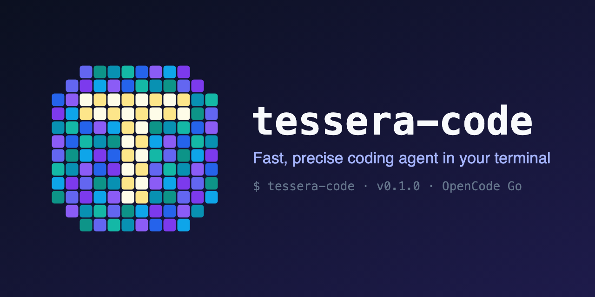

# tessera-code

<p align="center"></p>

Fast, precise single-agent coding CLI powered by the [OpenCode Go](https://opencode.ai) subscription.
Default model: `mimo-v2.6-flash`.

Design goal: **fast and accurate**. One agent, a small toolset (read/write/edit/glob/grep/bash), a short system prompt,
and fewer LLM round trips — files mentioned in a prompt are pre-attached and the project file list is in the system
prompt, so a typical "fix X in file Y" finishes in a single tool step.

## Install

```bash
curl -fsSL https://raw.githubusercontent.com/BOMONEI/tessera-code-cli/main/install.sh | bash
```

Then run `tessera-code` in a project folder and register your OpenCode Go API key once with `/auth <key>`.

- Needs Node.js 22+ and npm (the installer says how to get them if missing). Nothing else is downloaded: the
  package bundles everything.
- Installs the latest [release](https://github.com/BOMONEI/tessera-code-cli/releases) with `npm install -g`, after
  checking its SHA-256 against the release's `SHA256SUMS`. If the global npm folder is not writable (system Node),
  it installs under `~/.local` and tells you how to add `~/.local/bin` to PATH, instead of asking for sudo.
- When a newer release is out, the app says so at startup (`↑ x.y.z is available`, also in the bottom bar). It asks
  GitHub at each start, in the background; `"updateCheck": false` in `config.json` turns it off.
- Update: `tessera-code update` (`--check` only says whether one is available). It runs the new release's
  `install.sh`, checked against that release's `SHA256SUMS`, so updates go through the same verified path. A source
  checkout (`npm link`) is pointed at `git pull && npm ci && npm run build` instead of being replaced.
- A specific version: `curl -fsSL …/install.sh | TESSERA_VERSION=0.3.0 bash`. Remove: `npm uninstall -g tessera-code`.

## Build from source

```bash
npm install
npm run build
npm link            # optional: puts `tessera-code` on PATH
```

Releases: pushing a tag `vX.Y.Z` (matching `package.json`) runs `.github/workflows/release.yml`. It tests, builds
and packs the package and publishes a GitHub Release with the tarball, `SHA256SUMS` and `install.sh`.

Requires Node.js 22+. With nvm, run `nvm alias default 22` before `npm link`: nvm keeps global commands per Node
version, so a link made under another version is not on PATH after `nvm use 22`.

**API key.** Register your OpenCode Go API key once, in the TUI:

```
/auth <key>
```

The key is checked against OpenCode Go (a rejected key is not saved), stored as `"apiKey"` in
`~/.tessera-code/config.json` (readable by you only) and used right away. While you type it, the key is drawn as
dots; the transcript shows only `sk-…abcd`, and it is not kept in the prompt history. `/auth` without an argument
shows which key is in use. Outside the TUI, `tessera-code auth <key>` does the same.

Until a key is registered the app starts, but prompts are refused with a pointer to `/auth`. Keys of other tools
(such as an opencode CLI login) are not picked up; `OPENCODE_API_KEY` in the environment overrides the registered key
for one run (CI, scripts). Project settings (`.tessera/settings.json`) can never provide a key.

Some Go models (e.g. DeepSeek) require selecting **Global** in the workspace Privacy settings.

## Usage

```bash
tessera-code                       # interactive TUI
tessera-code "fix the failing test"  # TUI with an initial prompt
tessera-code -p "explain src/app.ts" # print mode (no prompts; edits/commands are denied unless the permission mode allows)
tessera-code -c                    # continue the latest session here
tessera-code -r                    # pick a session to resume (or -r <id prefix>)
tessera-code -m minimax-m3         # pick a model (see `tessera-code models`)
tessera-code --no-thinking         # reasoning off for this run (also: /think, ctrl+t)
tessera-code --repl                # plain readline UI
```

TUI keys:

| Key | Action |
|---|---|
| `enter` | send |
| `\` + `enter`, `option/alt+enter`, `shift+enter`* | new line (pasted text keeps its line breaks) |
| `↑` / `↓` | move between lines; on the first/last line, browse earlier prompts (saved per directory) |
| `ctrl+r` | search earlier prompts (`ctrl+r` again for older matches, `enter` to use) |
| `ctrl+g` | edit the prompt in `$VISUAL` / `$EDITOR` |
| `ctrl+o` | expand or fold tool output, diffs and thinking (folded by default) |
| `ctrl+l` | clear the screen and redraw the conversation (if the terminal left stale frames behind) |
| `/` | command menu with descriptions; after a command, its arguments (`/model`, `/mode`, `/think`, `/resume`, `/copy`). `enter` runs, `tab` completes |
| `@` | file picker (↑↓, tab/enter to insert) |
| `ctrl+v` | attach the clipboard image (screenshots); dragging image files into the terminal attaches them too |
| typing while the agent works | the message is delivered after the current step and steers the running turn (`↳`); if the turn was already answering, it runs next. `/` and `!` lines wait for the turn |
| `!command` | run a shell command directly; its output goes to the model with your next message (earlier `!` commands are suggested) |
| `ctrl+t` / `shift+tab` | toggle thinking / cycle permission mode |
| `esc` | interrupt |
| `ctrl+c` | copy the selected prompt text; otherwise clear the prompt; on an empty prompt interrupt (running) or exit (idle) |
| `shift+←/→/↑/↓`, `shift+home/end` | select text in the prompt (typing or backspace replaces it) |

\* `shift+enter` needs a terminal with the kitty keyboard protocol (kitty, Ghostty, WezTerm, recent iTerm2).
The terminal cursor follows the caret, so Korean/Japanese/Chinese IME composition shows in place. After a terminal
resize the history is redrawn at the new width. Images (PNG/JPEG/GIF/WebP, up to 10 MB) need a model that accepts them;
the default model and both fallbacks do.
A desktop notification (OSC 9 + bell) fires when a turn took longer than `notifyAfterSeconds` (default 20, `0` = off).

Slash commands:

| Command | |
|---|---|
| `/resume [id]` · `/sessions` · `/rename <title>` · `/fork` | session list/picker, title, copy the session and continue in the copy |
| `/undo` · `/rewind` · `/diff` | undo the last turn (files + messages), go back to any earlier prompt (code, conversation or both), show this session's file changes |
| `/new` (`/clear`) · `/compact [focus]` · `/context` | new session, summarize now, context usage |
| `/copy [n]` | copy the last response or one of its code blocks (pbcopy / wl-copy / xclip, OSC 52 over SSH) |
| `/model` · `/models` · `/think` · `/mode` | model (ZDR only), reasoning, permission mode |
| `/permissions` · `/cost` · `/mcp` · `/doctor` · `/init` · `/help` · `/exit` | allow rules, spend, MCP status, environment check, TESSERA.md |
| `/auth [key]` | register the OpenCode Go API key (verified, saved to `~/.tessera-code/config.json`); without a key, show the one in use |
| `/skills` · `/skill install\|new\|remove` · `/<skill> [task]` | list, add or run skills (see Skills) |
| `/providers` · `/auth <provider> <key>` · `/model <provider>/<model>` | connect and use other model providers (see Other providers) |
| `/agents [single\|subagents\|multi]` | single agent, subagents or parallel subagents (saved to config.json) |
| `/prompt [global\|project <text> \| remove g1]` | add your own instructions for every project or this project (see Configuration) |
| `/command` | keyboard shortcuts and what the bottom bar shows (`path ⎇ branch · ctx ▕██░░▏ · 5h ▕█░░░▏` / `model · thinking level · mode · mcp connected/configured`) |

Markdown commands from `~/.tessera-code/commands/*.md` and `.tessera/commands/*.md` are added too (`$ARGUMENTS` is substituted).

## Release notes

The first TUI run after an update shows one line, `✨ Updated to x.y.z (from …) · N changes`; `ctrl+o` expands the
notes for every version since the one last seen, and `/changelog [all|x.y.z]` shows them again any time. Notes come
from the packaged `CHANGELOG.md` (no network). A first install shows nothing; the last seen version is kept in
`~/.tessera-code/state.json`. `-p` and `--repl` runs do not count as seeing them.

## Sessions and undo

Sessions are stored per directory under `~/.tessera-code/sessions/` (JSONL). Each session keeps its title (generated
after the first prompt), model, thinking and its level, plan mode (other modes come from the config each run) and
usage, and resuming redraws the conversation. Before a turn first changes a file through the
write/edit tools, the file's previous content is saved, so `/undo` and `/rewind` can restore it — also after resuming.
A rewind first saves the files' current state, so running `/undo` right after it brings them back. Changes made by
shell commands are not tracked. When the conversation was compacted after a checkpoint, rewinding restores the files
only. Session switches and rewinds wait for a running turn; prompts typed meanwhile are queued.

## @ mentions

`@path` attaches a file (any type, including extensionless ones like `@Makefile`) and `@dir/` attaches a file listing.
Bare file names with an extension (`fix median.ts`) are attached too when they exist and are small. Files over 60 KB
or 2000 lines are attached partially and must be read before editing. Secrets (`.env*`, keys, credentials, tokens),
paths outside the project and `.git`/`.tessera` are never attached. In `--repl` mode, Tab completes `@` mentions.

## Images and documents

The agent's `read` tool looks at files the way you see them:

- **Images** (png, jpg, gif, webp) are shown to the model as images.
- **Documents** are rendered page by page as images: slides (pptx, ppt, key, odp), PDFs, Word (docx, doc, odt, rtf) and
  Excel (xlsx, xls, ods). Pictures, text drawn over pictures, charts and layout come through as they look, instead
  of the model unzipping the file and guessing from its XML. Up to 10 pages per read; the model asks for more with a
  range (`pages: "11-20"`). One page counts as about 1.5k tokens of context.

Rendering uses [LibreOffice](https://www.libreoffice.org) (free), only when a document is read; install it once
(`brew install --cask libreoffice`, or `apt install libreoffice-impress libreoffice-writer libreoffice-calc`), or point
`TESSERA_SOFFICE` at its `soffice`. Each render runs headless with its own temporary LibreOffice profile, so it does
not touch a LibreOffice window you have open. A model that cannot see images gets a message saying so (the default
`mimo-v2.6-flash` can).

## Other providers

OpenCode Go is the default. Other providers are added with a key and used as `<provider>/<model>`:

```
/auth openai <key>          # saved under "providers" in ~/.tessera-code/config.json
/model openai/gpt-5
/model openrouter/anthropic/claude-sonnet-4.5
/model ollama/qwen3:8b      # local servers need no key
```

`/providers` lists them with their state; `/models` lists every model you can pick now. Supported: OpenAI,
Anthropic (Claude), OpenRouter, Command Code, Google Gemini, xAI, DeepSeek, Mistral, Cohere, Groq, Cerebras, Together,
Fireworks, DeepInfra, Perplexity, Moonshot (Kimi), Z.ai (GLM), Alibaba (Qwen), NVIDIA NIM, Hugging Face, Baseten,
OpenCode Zen, and locally Ollama and LM Studio. Model lists, limits and prices come from models.dev. A key can also come
from the provider's usual environment variable (`OPENAI_API_KEY`, `ANTHROPIC_API_KEY`, `OPENROUTER_API_KEY`, …).

```json
"providers": {
  "openai":     { "apiKey": "sk-…" },
  "openrouter": { "apiKey": "sk-or-…", "zdr": true },
  "ollama":     { "baseURL": "http://127.0.0.1:11434/v1" }
}
```

**Data retention.** OpenCode Go stays limited to its zero-data-retention models. Other providers may keep prompts and
code under their own terms, so their models are marked **non-ZDR**: a warning when one is picked or used at startup,
and `non-ZDR` in red on the bottom bar. `"zdr": true` declares a ZDR agreement on your account (for OpenRouter it also
makes every request ask for ZDR endpoints only); local servers count as ZDR. Keys and addresses are read from your own
config only, never from a project's `.tessera/settings.json`. The OpenCode Go fallback chain applies to Go models
only, and the 5h gauge counts Go spend only.

## Skills

Skills are folders with a `SKILL.md` (front matter `name` and `description`, then instructions) plus any scripts or
reference files — the same format as Claude Code, whose skills work here too. The agent sees one line per skill and
loads a skill with its `skill` tool when a task fits; `/<name> [task]` runs one directly.

| Where | |
|---|---|
| `.tessera/skills/<name>/` | this project (used once you trust the project) |
| `~/.tessera-code/skills/<name>/` | every project |
| `.claude/skills/<name>/` | this project's Claude skills (trusted projects) |
| `~/.claude/skills/<name>/` | your Claude skills |

On a name clash the first in this order wins. `/skills` lists them; `/skill install <git URL|folder> [global|project]`
copies skills in (a folder with `SKILL.md`, or every `*/SKILL.md` / `skills/*/SKILL.md`; existing ones are not
replaced); `/skill new <name> [global|project]` creates one to fill in; `/skill remove <name>`. A project's own skills
are instructions from the repository, so like its hooks and MCP servers they are used only after you trust the project
(asked again when they change).

## Subagents and multi-agent

Off by default: one agent does everything, which is fastest. `/agents` (or `"subagents"` / `"multiAgent"` in
`config.json`) switches:

| Mode | config | |
|---|---|---|
| `single` | both `false` | no delegation |
| `subagents` | `"subagents": true` | the agent may hand a self-contained job to a subagent with its own context (`task` tool): `explore` reads only, `general` may edit and run commands under the same permissions; one at a time |
| `multi` | `"multiAgent": true` | as above, with up to 4 subagents running in parallel for independent parts |

The choice is saved and applies at once; the bottom bar shows `agents: sub` / `agents: multi`, and the spinner shows
what a subagent is doing. Subagents cost extra requests (their spend counts toward the session and the 5h budget), so
they pay off for broad research and independent work, not small edits.

## Configuration

The first run creates `~/.tessera-code/config.json` with the main defaults and an empty API key (an existing file is
never overwritten; one without `"apiKey"` gets the entry added):

```json
{
  "apiKey": "",
  "model": "mimo-v2.6-flash",
  "thinking": true,
  "thinkingLevel": "medium",
  "showThinking": true,
  "permissionMode": "default",
  "mcpServers": {
    "exa": { "type": "remote", "url": "https://mcp.exa.ai/mcp", "enabled": true }
  }
}
```

| Key | Values | |
|---|---|---|
| `model` | a ZDR model id (`tessera-code models`) | startup model |
| `thinking` | `true` / `false` | reasoning on/off (`ctrl+t`, `/think on\|off`) |
| `thinkingLevel` | `low` / `medium` / `high` | effort when thinking is on (`/think low\|medium\|high`) |
| `showThinking` | `true` / `false` | show the thinking text live, then folded (`/think show\|hide`; `ctrl+o` always shows it) |
| `permissionMode` | `default` (ask) / `acceptEdits` (alias `edit`) / `plan` (read-only) / `bypass` (ask only for destructive commands and protected paths) / `dangerous` (never ask) | startup mode; `shift+tab` and `/mode` change it here too, so the new mode applies to every project from then on |
| `mcpServers` | name → `{ "command", "args", "env" }` or `{ "url", "headers" }` | the built-in `exa` web search server is always there; `"enabled": false` turns it off |

`--model`, `--thinking`/`--no-thinking` and `--permission-mode` override these for one run (without saving).
`default` asks before every edit, command and MCP call ("always allow" remembers an answer per project). `bypass`
runs edits and commands without asking, also in `-p` mode. Two cases still
ask in every mode (in `-p` mode they are denied): destructive commands (`rm -rf`, `sudo`, `git push --force`,
`git reset --hard`, `find -delete` or `-exec rm …`, piping into a shell or interpreter, …) and edits outside the project
or inside `.git`, `.tessera` and `~/.tessera-code`. `dangerous` asks for nothing at all, those included; it is not in
the `shift+tab` cycle, so choose it with `/mode dangerous`, `--permission-mode dangerous` or the config file.

All settings, in `~/.tessera-code/config.json` (global) and `.tessera/settings.json` (project, overrides global; `allow` and `hooks` merge):

```json
{
  "model": "mimo-v2.6-flash",
  "thinking": true,
  "thinkingLevel": "medium",
  "permissionMode": "default",
  "notifyAfterSeconds": 20,
  "fallback": { "models": ["glm-5.3-flash", "qwen3.8-flash"], "firstTokenTimeoutMs": 0, "stickyMs": 300000 },
  "maxSteps": 50,
  "contextLimit": 500000,
  "allow": ["bash(npm test *)", "edit"],
  "mcpServers": {
    "fs": { "command": "npx", "args": ["-y", "some-mcp-server"] },
    "remote": { "url": "https://example.com/mcp", "headers": { "Authorization": "Bearer ..." } }
  },
  "hooks": {
    "PreToolUse": [{ "matcher": "bash", "command": "./scripts/check-cmd.sh" }],
    "PostToolUse": [{ "matcher": "edit|write", "command": "npx prettier --write \"$(jq -r .input.path)\"" }],
    "UserPromptSubmit": [{ "command": "echo 'extra context'" }],
    "Stop": [{ "command": "say done" }]
  }
}
```

Every install has the **exa** web search server (`https://mcp.exa.ai/mcp`, tools `web_search_exa` and
`web_fetch_exa`, no key needed). It is written into `config.json` on first run (and added to an existing one that
lacks it), and loaded even if the entry is deleted; set `"enabled": false` on it, globally or in a project's
settings, to turn it off. Entries may use opencode's form (`"type": "remote" | "local"`, `"enabled"`).

Servers connect in the background from startup, and each one's tools are usable as soon as it is connected. A
prompt sent before they are all up waits at most 1.5 s; a server still connecting then (slow or unreachable ones can
take up to their 15 s connect timeout) joins from the next prompt, and the turn says so.

The bottom bar shows `mcp 2/3`: servers connected out of configured (yellow while starting, red when one failed); `/mcp`
lists each server with its tools or error.

Project-level `hooks`, `mcpServers`, `allow` and `permissionMode` run code or widen permissions, so they are ignored until you trust the project (asked once per change of those settings; never in `-p` mode). "Always allow" answers are stored per project under `~/.tessera-code/projects/`, not in the repo.

`contextLimit` (default 500k tokens) caps the context. A turn that outgrows it is not cut short: it finishes, and the history is summarized right after it (the progress shows under the answer), so the next prompt starts small. Only when a single turn nears the model's real window (90%) does it compact between tool steps. A prompt that would itself cross the limit compacts first. `/context` shows usage against the limit, `/compact [focus]` compacts on demand.

Hooks receive a JSON payload on stdin. Exit `0` continues (stdout becomes context for `UserPromptSubmit`), exit `2` blocks with stderr as the reason.

**Instructions.** The default working rules (reply in your language, verify, no unsolicited commits, ask when unclear,
final inspection, …) are built into the system prompt. Your own instructions are added on top and take precedence:

- `/prompt global <text>` — every project; saved in `~/.tessera-code/TESSERA.md`.
- `/prompt project <text>` — this project only; saved in `<project>/.tessera/TESSERA.md` (kept out of the project root so it
  never hides a `TESSERA.md`, `AGENTS.md` or `CLAUDE.md` there).
- `/prompt <text>` asks which of the two; `/prompt` lists them (g1, p1, …); `/prompt remove g1` removes one. Changes
  apply from the next message.

Added prompts are bullets under `## Added with /prompt` in those files; you can also edit the files by hand, and
anything else in them is kept. Instructions are also read from `TESSERA.md` (or `AGENTS.md` / `CLAUDE.md`) in the
working directory and its parents. An unedited copy of the defaults that earlier versions put in
`~/.tessera-code/TESSERA.md` is removed (the rules are built in now); an edited one is kept.

## Performance

The model's own speed cannot be changed, so everything around it is kept off the critical path:

- **Startup**: the CLI is bundled with esbuild (`npm run build` → `dist/bundle`), React runs its production build, and
  heavy parts load only when needed (TUI for interactive runs, the markdown renderer after the first frame, MCP SDK
  only with servers configured). `tessera-code -v` takes ~0.07s; the TUI is ready in ~0.27s.
- **Network**: one keep-alive connection pool (60s idle) for all API calls, warmed up in the background at startup,
  so turns do not pay a TLS handshake (~300-400ms) after the user paused for more than 4s (Node's default).
- **Nothing blocks startup**: the model catalog is refreshed in the background, MCP servers connect in the
  background (the first turn waits only if they are still starting), git info is read concurrently.
- **Per turn**: read-only tools (read/glob/grep) start as soon as their call streams in instead of after the whole
  model response; provider clients and markdown renderers are reused; the usage ledger and session list are read
  incrementally (session summaries are indexed by mtime).
- Each turn ends with `⏱ total (first token …)` so model latency and agent overhead are visible.

The packed tarball has no runtime dependencies (everything is in the bundle), so `npm install -g ./tessera-code-*.tgz`
works offline.

## Architecture

```
src/
  cli.ts            entry: TUI / REPL / print mode, subcommands
  app.ts            wires config, catalog, permissions, tools, MCP, hooks, agent
  agent/            agent loop (AI SDK streamText), system prompt, file attachments, compaction
  providers/        models.dev catalog -> chat/messages/responses routing; x-opencode-session header
  tools/            read write edit glob grep bash
  permissions.ts    modes, allow rules, dangerous-command guard
  hooks.ts mcp.ts   extensibility
  session/          JSONL session store (~/.tessera-code/sessions)
  cost/             local spend ledger vs Go 5h/week/month caps
  ui/               Ink TUI, readline REPL, formatting
```

`npm run poc` runs the Phase 1 provider check across all three API formats.

`npm run assets` regenerates `assets/icon.{svg,png}` and `assets/thumbnail.{svg,png}` from the pixel map in
`src/ui/logo.ts`, which also draws the startup card's icon in the terminal (truecolor half-blocks).

## Thinking

`thinking: true` (default) lets reasoning models deliberate before acting; `false` sends `reasoning: 'none'`.
Measured on mimo-v2.6-flash via Go: thinking off cuts output tokens roughly in half but wall time is dominated by
upstream latency, and it answered a multi-step arithmetic question wrongly where thinking on was correct.
Keep it on by default; turn it off for trivial edits. The level (`thinkingLevel`, default `medium`) is always sent
explicitly: with the provider default, mimo-v2.6-flash started answering later (median 8.2s vs 5.2s at `medium` over
7 identical requests). While the model thinks, the TUI streams its reasoning dimly; afterwards it folds into one
line (`ctrl+o` shows it in full).

## Fallback

When a request fails with an error before any output — an HTTP error status (4xx/5xx: rate limit, overload, bad
request…), a network failure, or a provider error at the start of the stream — the same request is retried on the next
model in `fallback.models`. 401/403 are not retried (every model uses the same API key). Once output has started the
request stays on that model. After a switch, the fallback model is used for `stickyMs` (5 min) before the main model is
retried. Slow responses are waited for; set `firstTokenTimeoutMs` (e.g. 30000) to also switch when a model stays silent
that long (the last model in the chain is never timed out). Only zero-data-retention models are accepted (others are ignored with a
warning); the allowlist lives in `src/providers/catalog.ts` and mirrors the OpenCode Go privacy table.

Default chain (OpenCode Go, Go plan, checked 2026-10-13):

| Model | $/1M in · out · cached | Go monthly limit | Est. requests / 5h | ZDR |
|---|---|---|---|---|
| mimo-v2.6-flash (main) | 0.14 · 0.28 · 0.0028 | $60 | 30,100 | yes |
| glm-5.3-flash (fallback 1) | 0.15 · 0.50 · 0.03 | $60 | 6,320 | yes |
| qwen3.8-flash (fallback 2) | 0.15 · 0.47 · 0.016 | $30 | 5,400 | yes |

Go limits are per model, so fallback traffic draws on the fallback model's own allowance, not the main model's.
Both fallbacks run on upstreams independent of MiMo. qwen3.8-flash uses the Anthropic messages format; the
wrapper converts the shared history automatically.
